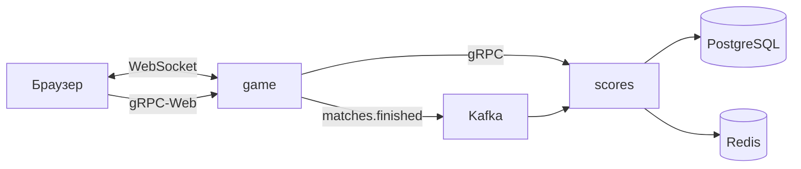

# Orbital Run — Go-бэкенд

Сервер для аркады, в которой игрок соревнуется с ботом за кристаллы. Бэкенд
ведёт онлайн-матчи по WebSocket, сохраняет их результаты и отдаёт общий топ-10
через gRPC и gRPC-Web. [Клиент игры](https://github.com/lagatun54/orbital-run-frontend)
находится в отдельном репозитории.

## Быстрый запуск

Нужны Git, Docker и Docker Compose. Склонируйте репозиторий и запустите сервисы.

```sh
git clone https://github.com/lagatun54/orbital-run-backend.git
cd orbital-run-backend
cp .env.example .env
docker compose up -d --build --wait
curl -fsS -o /dev/null -w '%{http_code}\n' http://localhost:8080/healthz
```

Если игровой сервер видит брокер сообщений, проверка вернёт `204`. Чтобы
проверить и сервис рейтинга, вызовите RPC через `grpcurl`:

```sh
grpcurl -plaintext -import-path api -proto scores/v1/leaderboard_service.proto \
  -d '{}' localhost:8080 orbital.scores.v1.LeaderboardService/GetLeaderboard
```

На пустой базе список будет пуст. Для игры запустите клиент по
[его инструкции](https://github.com/lagatun54/orbital-run-frontend#readme).
Укажите адрес API `http://localhost:8080` в настройках клиента, а в `.env`
бэкенда задайте `FRONTEND_ORIGIN` равным адресу страницы клиента без пути
и завершающего слеша. По умолчанию это `http://localhost:5173`.

| Переменная Compose | Назначение | По умолчанию |
| --- | --- | --- |
| `GAME_PORT` | Локальный порт API | `8080` |
| `GAME_MAX_MATCHES` | Лимит одновременных матчей на экземпляр `game` | `64` |
| `POSTGRES_PASSWORD` | Пароль локальной базы | `orbital` |
| `REDIS_URL` | Адрес кэша; пустое значение отключает кэш | `redis://redis:6379/0` |

```sh
docker compose logs -f game scores
docker compose down
```

Обычный `docker compose down` сохраняет тома с данными PostgreSQL и Kafka.

## Как работает сервер



1. [`game`](cmd/game/main.go) принимает направление движения по WebSocket
   на `/ws`. [Игровой цикл](internal/game/session.go) обновляет арену 20 раз
   в секунду: сервер рассчитывает движение игрока и бота, сбор кристаллов и счёт.
2. После матча `game` отправляет событие в Kafka с ID матча как ключом.
   [`scores`](cmd/scores/main.go) читает события из топика `matches.finished`
   и подтверждает обработку после записи в PostgreSQL. Если база недоступна,
   обработка повторяется; повторная доставка того же ID не создаёт дубль.
3. [`scores`](internal/scores/store.go) читает топ-10 из Redis. Снимок живёт
   до 30 секунд; при промахе или недоступности Redis сервис читает PostgreSQL.
   Результаты сортируются по убыванию счёта, затем по времени завершения и ID.

| Публичный API | Что делает |
| --- | --- |
| `GET /ws` | Открывает WebSocket для онлайн-матча |
| `GET /healthz` | Проверяет доступность брокера для `game` |
| [`LeaderboardService.GetLeaderboard`](api/scores/v1/leaderboard_service.proto) | Возвращает общий топ-10 |
| [`ResultsService.GetResult`](api/scores/v1/results_service.proto) | Возвращает результат и его место в рейтинге по ID |
| [`ResultsService.SaveLocalResult`](api/scores/v1/results_service.proto) | Принимает счёт, рассчитанный клиентом, и помечает результат как локальный |

Точки входа — в [`cmd/`](cmd/), маршруты и Protobuf-контракты —
в [`api/`](api/), правила арены и логика бота — в [`internal/`](internal/),
схема и запросы PostgreSQL — в [`db/`](db/). Как обновить контракты и
сгенерировать код клиента, описано в [руководстве по gRPC](docs/frontend-grpc-migration.md).

## Проверки и выпуск

Для локальных проверок нужна версия Go из [`go.mod`](go.mod). Юнит-тестам и
интеграционным тестам Docker не нужен; интеграционные тесты открывают локальные
TCP-сокеты. Сквозные тесты поднимают отдельный стек Compose.

```sh
make check   # Go-модули и go vet
make test    # тесты с детектором гонок
make e2e     # матчи, рейтинг, сбои сервисов и масштабирование
```

На отдельном тестовом стеке можно замерить интервалы между игровыми кадрами
под нагрузкой: `go run ./tests/load -url http://127.0.0.1:8080 -matches 64 -max-p99 75ms`.
Этот сценарий играет полные матчи и записывает их результаты в рейтинг.

[Руководство по развёртыванию](docs/deployment.md) описывает публикацию образа
в GHCR, запуск с Caddy, масштабирование `game` и вариант с Northflank и NATS.
