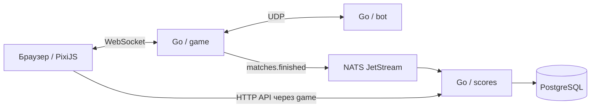

# Орбитальный сбор

Браузерная 2D-аркада на PixiJS и Go. За 30 секунд соберите больше кристаллов, чем бот. Управление стрелками, WASD или экранными кнопками. После раунда сервер отправляет результат в общий топ-10.

## Локальный запуск

Понадобится Docker с Compose v2.

```sh
docker compose up --build
```

Откройте [игру](http://localhost:8080). Чтобы использовать другой порт, запустите Compose с переменной `GAME_PORT`.

Если основной Go-прокси возвращает ошибку при сборке, можно указать доступный прокси через `GO_MODULE_PROXY`.

```sh
docker compose logs -f game bot scores
docker compose down
```

Таблица и очередь хранятся в именованных Docker-томах между запусками.

Чтобы локально проверить раздельный запуск, сначала остановите общий стек
командой `docker compose down`. Запустите бэкенд на порту 8080:

```sh
APP_TARGET=backend FRONTEND_ORIGIN=http://localhost:5173 docker compose up -d --build --wait
```

Затем соберите и запустите фронтенд отдельно (понадобятся Node.js 22 и Python 3):

```sh
npm ci
BACKEND_URL=http://localhost:8080 npm run build
python3 -m http.server 5173 --bind 127.0.0.1 --directory dist
```

Откройте `http://localhost:5173`: этот адрес должен совпадать с `FRONTEND_ORIGIN`.

## Как проходит матч



- **game** ведёт серверную симуляцию с частотой 20 Гц и обрабатывает до 64 матчей одновременно. Браузер отправляет направление движения. Сервер определяет позиции, момент сбора кристаллов и итоговый счёт.
- **bot** получает снимки арены по UDP и отвечает направлением к ближайшему кристаллу. Ответ содержит номер снимка. Сервер отбрасывает устаревшие ответы и перестаёт применять последнюю команду через 500 мс.
- **scores** читает очередь JetStream с явным подтверждением. После записи в Postgres воркер подтверждает доставку. При временной ошибке записи запрашивает повторную доставку. Первичный ключ результата защищает таблицу от дублей.
- **API** отдаёт топ-10 через `GET /api/leaderboard` и результат с общим местом через `GET /api/results/{id}`. Выше стоят раунды с большим счётом. При равном счёте выше более ранний раунд, а при совпадении времени порядок определяет ID результата.

## Демо очереди

```sh
docker compose stop scores
```

Сыграйте полный раунд. Сервер покажет счёт и отправит результат в JetStream. Запустите сервис рекордов снова.

```sh
docker compose start scores
curl http://localhost:8080/api/leaderboard
```

Событие будет обработано после запуска воркера. Обновите страницу, чтобы увидеть рейтинг.

## Раздельный выпуск через GitHub

Проверки идут в **Actions → Frontend** и **Actions → Backend**. Изменения в
основной ветке запускают выпуск затронутого компонента. Оба workflow также можно
запустить вручную с основной ветки через **Run workflow**.

### Фронтенд: GitHub Pages

1. В репозитории включите **Settings → Pages → Source → GitHub Actions**.
2. Когда появится бэкенд, задайте переменную репозитория **Settings → Secrets and
   variables → Actions → Variables → `BACKEND_URL`**. Значение — адрес API по
   HTTPS без пути, например `https://api.example.com`.
3. Запустите **Actions → Frontend**. Адрес опубликованной страницы будет в
   результате деплоя. Фронтенд можно опубликовать раньше бэкенда, но матчи и
   рейтинг заработают после подключения API. После изменения `BACKEND_URL`
   запустите **Frontend** ещё раз.

### Бэкенд: GHCR и Docker Compose

**Backend** проверяет Go и запускает Compose с образом без фронтенда. После
успешной проверки в основной ветке он публикует образ для Linux AMD64 и ARM64
в `ghcr.io/<владелец>/<репозиторий>-backend`. Ссылка на конкретный образ с
`@sha256:…` появится в **Summary** запуска.

Для постоянной работы бэкенда нужен Linux-хост с Docker Compose v2: GitHub
Pages обслуживает статику, GHCR хранит образ, а раннер GitHub Actions работает
только на время задачи. Для доступа из Pages направьте домен API на хост и
откройте 80 и 443 для Caddy. В домашнем каталоге пользователя деплоя создайте
каталог `orbital-backend` с файлом `.env`:

```dotenv
DEMO_DOMAIN=api.example.com
FRONTEND_ORIGIN=https://owner.github.io
POSTGRES_PASSWORD=replace_with_generated_hex
```

`FRONTEND_ORIGIN` — адрес страницы без пути и завершающего слеша. Для
`https://owner.github.io/repo/` это `https://owner.github.io`; для собственного
домена укажите его. Сгенерируйте пароль через `openssl rand -hex 24` и
ограничьте доступ к файлу командой `chmod 600 .env`. Если пакет GHCR приватный,
один раз выполните на хосте `docker login ghcr.io` с токеном с доступом
`read:packages`.

Чтобы выкатывать бэкенд из GitHub:

1. В **Settings → Environments** создайте окружение `backend`, доступное
   только из основной ветки.
2. Задайте в окружении переменные `BACKEND_SSH_HOST` (имя хоста или IPv4,
   SSH-порт 22) и `BACKEND_SSH_USER` (пользователь с доступом к Docker).
   Добавьте секреты `BACKEND_SSH_KEY` (приватный ключ пользователя деплоя) и
   `BACKEND_SSH_KNOWN_HOSTS` (строка `known_hosts` с проверенным ключом хоста).
3. Задайте переменную **репозитория** `DEPLOY_BACKEND=true` и запустите
   **Backend**. Workflow загрузит файлы Compose и Caddy, запустит
   опубликованный образ и дождётся готовности сервисов. Проверить API можно
   через `curl -fsS https://api.example.com/api/leaderboard`.

Если нужно запустить бэкенд вручную, скопируйте `compose.yaml`,
`compose.public.yaml` и `Caddyfile` в каталог с `.env`, подставьте ссылку на
образ из **Summary** и выполните:

```sh
BACKEND_IMAGE='ghcr.io/owner/repo-backend@sha256:…' \
  docker compose -f compose.yaml -f compose.public.yaml \
    up -d --no-build --pull always --wait
```

Для отката можно запустить ту же команду с предыдущим digest. Данные
PostgreSQL и JetStream сохраняются в томах Compose.

### Демо на Northflank Sandbox

В проекте нужны PostgreSQL 17 и два сервиса:

- `orbital-nats` запускает `nats:2.14-alpine` с аргументами
  `-js -sd /tmp/jetstream`. Порт TCP `4222` доступен внутри проекта.
  Без постоянного тома очередь может сброситься при замене контейнера.
- `orbital-run` собирается из корневого `Dockerfile` с target `northflank`.
  В одном контейнере запускаются `game`, `bot` и `scores`. Откройте только
  HTTP-порт `8080`, чтобы Northflank выдал адрес HTTPS.

В runtime-переменных `orbital-run` задайте `NATS_URL=nats://orbital-nats:4222`
и `FRONTEND_ORIGIN=https://lagatun54.github.io`. Подключите
`POSTGRES_URI` из addon через Secret Group с алиасом `DATABASE_URL`.
Проверьте `/api/leaderboard` на публичном адресе сервиса и используйте этот
адрес в `BACKEND_URL` при следующем запуске **Frontend**.

## Публичное демо на одном хосте

Для живого демо понадобится Linux-хост с Docker Compose и домен, указывающий на его IP. Откройте порты 80 и 443. Caddy получит сертификат и будет проксировать HTTPS и WebSocket к игре. UDP-порт бота, NATS и PostgreSQL доступны внутри сети Compose.

Склонируйте репозиторий на хост и создайте файл `.env` с реальным доменом и случайным паролем в hex. Пароль можно сгенерировать командой `openssl rand -hex 24`.

```dotenv
DEMO_DOMAIN=game.example.com
POSTGRES_PASSWORD=replace_with_generated_hex
```

```sh
docker compose -f compose.yaml -f compose.public.yaml up -d --build
```

Откройте настроенный адрес по HTTPS. После проверки добавьте ссылку **«Играть онлайн»** в начало README на GitHub.

## Проверки

```sh
go test -race ./...
npm ci
npm run build
```
