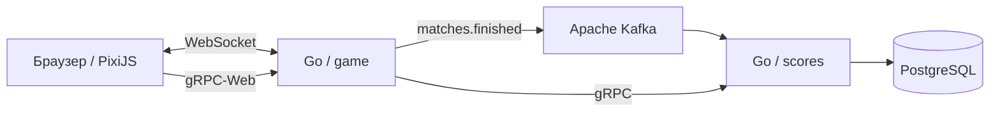

# Орбитальный сбор

Браузерная 2D-аркада на PixiJS и Go. За 30 секунд соберите больше кристаллов, чем бот. Управление стрелками, WASD или экранными кнопками. После раунда сервер отправляет результат в общий топ-10.

## Разделение репозиториев

Go-бэкенд и [клиент игры](https://github.com/lagatun54/orbital-run-frontend)
собираются и публикуются из отдельных репозиториев. Клиент подключается по
gRPC-Web для рейтинга и результатов и по WebSocket на `/ws` для матча.
При переходе с REST обновите бэкенд и браузерный клиент в рамках одного выпуска.
См. [инструкцию по миграции клиента](docs/frontend-grpc-migration.md).

## Локальный запуск

Понадобится Docker с Compose v2. Укажите origin клиентского сервера:

```sh
FRONTEND_ORIGIN=http://localhost:5173 docker compose up -d --build --wait
grpcurl -plaintext -import-path api -proto scores/v1/leaderboard_service.proto \
  -d '{}' localhost:8080 orbital.scores.v1.LeaderboardService/GetLeaderboard
```

Для ручной проверки установите `grpcurl`. Для другого порта API задайте
`GAME_PORT`. При ошибке Go-прокси можно указать `GO_MODULE_PROXY`.
PostgreSQL и Kafka сохраняют данные в Docker-томах, а `kafka-init` создаёт
топик `matches.finished`.

Запустите клиент по инструкции в [README клиента](https://github.com/lagatun54/orbital-run-frontend#readme).
Его адрес должен совпадать с `FRONTEND_ORIGIN` (без пути и завершающего слеша).

```sh
docker compose logs -f game scores
docker compose down
```

## Как проходит матч

### С чего начать читать код

```text
api/             WebSocket, Protobuf-контракты и обработчики RPC
cmd/             точки запуска game, scores и orbital-stack
config/          чтение переменных окружения
db/              подключение к PostgreSQL и хранилище результатов
  migration/     SQL-схема, которую scores применяет при запуске
  query/         запросы записи и чтения результатов
internal/        игровые правила, цикл матча, бот, брокер и управление процессами
tests/           юнит-, интеграционные и сквозные тесты
```

В каждой папке `cmd/` один `main.go`. Команда читает настройки и подключает
нужные пакеты. Управление ботом рассчитывается внутри процесса `game`.

| Что ищу | Где смотреть |
| --- | --- |
| Публичные маршруты, включая `/ws` и API рейтинга | [api/routes.go](api/routes.go) |
| Как бот выбирает направление к ближайшему кристаллу | [internal/bot/steering.go](internal/bot/steering.go) |
| Как браузер подключается к матчу и передаёт нажатия | [match_handler.go](api/match_handler.go), [client_message.go](api/client_message.go) |
| Что происходит на каждом тике и как начисляются очки | [session.go](internal/game/session.go) вызывает [`Match.Step`](internal/arena/arena.go) |
| Как результат матча попадает в очередь и затем в PostgreSQL | [result.go](internal/game/result.go) публикует событие, [consumer.go](internal/scores/consumer.go) принимает его, [postgres.go](db/postgres.go) сохраняет |
| Как сервер отвечает на запросы рейтинга | [api/scores_handler.go](api/scores_handler.go) и [SQL-запросы](db/query) |

Файлы с интерфейсами названы по самим интерфейсам.

- Игровой цикл передаёт результаты через [`ResultPublisher`](internal/game/result_publisher.go).
- RPC-обработчики рейтинга и результатов используют [`ResultStore`](internal/scores/result_store.go).
  Для записи результатов из очереди достаточно [`ResultWriter`](internal/scores/result_writer.go).
- Kafka и NATS реализуют [`Producer`](internal/broker/producer.go) и
  [`Consumer`](internal/broker/consumer.go).

### Поток данных



- **game** ведёт серверную симуляцию с частотой 20 Гц. Переменная `GAME_MAX_MATCHES` задаёт число слотов на экземпляр `game` (по умолчанию 64). Браузер отправляет направление движения. Сервер определяет позиции, момент сбора кристаллов и итоговый счёт. По завершении матча сервер публикует результат в Kafka с ID матча в качестве ключа сообщения.
- На каждом тике `game` направляет бота к ближайшему кристаллу.
- **scores** читает топик `matches.finished` в группе `scores` и фиксирует смещение после записи в PostgreSQL. При недоступности PostgreSQL повторяет обработку с того же смещения до восстановления базы. Первичный ключ результата защищает таблицу от дублей при повторной доставке.
- [`LeaderboardService`](api/scores/v1/leaderboard_service.proto) отдаёт топ-10 через `GetLeaderboard`. Выше стоят раунды с большим счётом. При равном счёте выше более ранний раунд, а при совпадении времени порядок определяет ID результата.
- [`ResultsService`](api/scores/v1/results_service.proto) возвращает результат и место через `GetResult`, а через `SaveLocalResult` принимает результат локального матча.

### Генерация клиентов и обработчиков

Исходные `.proto` лежат в `api/scores/v1`. Для обновления сгенерированного кода
установите Buf 1.75.0 и добавьте генераторы в `PATH`. Команды выполняются из
корня бэкенда, рядом с клоном `orbital-run-frontend`.

```sh
go install google.golang.org/protobuf/cmd/protoc-gen-go@v1.36.10
go install connectrpc.com/connect/cmd/protoc-gen-connect-go@v1.19.1
buf generate
npm exec --package=@bufbuild/protoc-gen-es@2.17.0 -- \
  buf generate --template buf.gen.web.yaml --output ../orbital-run-frontend
```

## Демо очереди

```sh
docker compose stop scores
```

Сыграйте полный раунд. Сервер покажет счёт и отправит результат в Kafka.
Состояние группы потребителей можно посмотреть командой:

```sh
docker compose exec kafka /opt/kafka/bin/kafka-consumer-groups.sh \
  --bootstrap-server kafka:9092 --describe --group scores
```

Запустите сервис рекордов снова.

```sh
docker compose start --wait scores
grpcurl -plaintext -import-path api -proto scores/v1/leaderboard_service.proto \
  -d '{}' localhost:8080 orbital.scores.v1.LeaderboardService/GetLeaderboard
```

`scores` обработает событие после подключения к Kafka. Обновите страницу, чтобы увидеть рейтинг.

## Раздельный выпуск через GitHub

Бэкенд публикуется из этого репозитория через **Actions → Backend**.
Настройка GitHub Pages для отдельного клиентского репозитория описана в
[README клиента](https://github.com/lagatun54/orbital-run-frontend#readme).

### Бэкенд: GHCR и Docker Compose

**Backend** проверяет Go и запускает Compose с образом без фронтенда. После
успешной проверки в основной ветке он публикует образ для Linux AMD64 и ARM64
в `ghcr.io/<владелец>/<репозиторий>-backend`. Ссылка на конкретный образ с
`@sha256:…` появится в **Summary** запуска.

Для постоянной работы бэкенда нужен Linux-хост с Docker Compose 2.24.4 или новее: GitHub
Pages обслуживает статику, GHCR хранит образ, а раннер GitHub Actions работает
только на время задачи. Для доступа из Pages направьте домен API на хост и
откройте 80 и 443 для Caddy. В домашнем каталоге пользователя деплоя создайте
каталог `orbital-backend` с файлом `.env`:

```dotenv
DEMO_DOMAIN=api.example.com
FRONTEND_ORIGIN=https://owner.github.io
POSTGRES_PASSWORD=replace_with_generated_hex
```

`FRONTEND_ORIGIN` — адрес страницы без пути и завершающего слеша. Для
`https://owner.github.io/repo/` это `https://owner.github.io`; для собственного
домена укажите его. Сгенерируйте пароль через `openssl rand -hex 24` и
ограничьте доступ к файлу командой `chmod 600 .env`. Если пакет GHCR приватный,
один раз выполните на хосте `docker login ghcr.io` с токеном с доступом
`read:packages`.

Чтобы выкатывать бэкенд из GitHub:

1. В **Settings → Environments** создайте окружение `backend`, доступное
   только из основной ветки.
2. Задайте в окружении переменные `BACKEND_SSH_HOST` (имя хоста или IPv4,
   SSH-порт 22) и `BACKEND_SSH_USER` (пользователь с доступом к Docker).
   Добавьте секреты `BACKEND_SSH_KEY` (приватный ключ пользователя деплоя) и
   `BACKEND_SSH_KNOWN_HOSTS` (строка `known_hosts` с проверенным ключом хоста).
3. Задайте переменную **репозитория** `DEPLOY_BACKEND=true` и запустите
   **Backend**. Workflow загрузит файлы Compose и Caddy, запустит
   опубликованный образ и дождётся готовности сервисов. Проверьте загрузку
   общего рейтинга в браузерном клиенте с новым адресом бэкенда.

Если нужно запустить бэкенд вручную, скопируйте `compose.yaml`,
`compose.public.yaml` и `Caddyfile` в каталог с `.env`, подставьте ссылку на
образ из **Summary** и выполните:

```sh
BACKEND_IMAGE='ghcr.io/owner/repo-backend@sha256:…' \
  docker compose -f compose.yaml -f compose.public.yaml \
    up -d --no-build --pull always --wait
```

Для отката подставьте предыдущий digest и используйте файлы Compose из
соответствующего выпуска. Данные PostgreSQL и Kafka сохраняются в томах Compose.

При обновлении с версии, использующей NATS, дайте старому `scores` обработать очередь
JetStream перед обновлением. Уже записанные результаты остаются в PostgreSQL.
Kafka начинает работу со своим топиком и собственной группой потребителей.

Если связь пропала до начала матча, игра запускает локальный раунд. Браузер
сохраняет завершённый результат и отправляет его при восстановлении доступа
к API. В общем рейтинге такие записи помечены «локально», поскольку счёт
рассчитан на клиенте. При равных очках для локальной записи используется время
её приёма сервером.

### Демо на Northflank Sandbox с NATS JetStream

В проекте нужны PostgreSQL 17 и два сервиса:

- `orbital-nats` запускает `nats:2.14-alpine` с аргументами
  `-js -sd /tmp/jetstream`. Порт TCP `4222` доступен внутри проекта.
  Без постоянного тома очередь может сброситься при замене контейнера.
- `orbital-run` собирается из корневого `Dockerfile` с target `northflank`.
  В одном контейнере запускаются `game` и `scores`. Откройте только
  HTTP-порт `8080`, чтобы Northflank выдал адрес HTTPS.

В runtime-переменных `orbital-run` задайте `NATS_URL=nats://orbital-nats:4222`
и `FRONTEND_ORIGIN=https://lagatun54.github.io`. Сервисы используют NATS,
когда задан `NATS_URL` и пуст `KAFKA_BROKERS`. Подключите
`POSTGRES_URI` из addon через Secret Group с алиасом `DATABASE_URL`.
Задайте публичный адрес сервиса в `BACKEND_URL` при следующем запуске
**Frontend** и проверьте загрузку рейтинга в браузере.

Если прямой адрес Northflank недоступен из сети игрока, можно развернуть
[прокси на Render](https://render.com/deploy?repo=https%3A%2F%2Fgithub.com%2Flagatun54%2Forbital-run).
Прокси передаёт gRPC-Web и WebSocket на Northflank. Задайте адрес Render
в `BACKEND_URL`, запустите **Frontend** и проверьте рейтинг из нужной сети. На бесплатном тарифе первый запрос
после простоя может занять около минуты.

## Публичный API на одном хосте

Для публичного API нужен Linux-хост с Docker Compose и доменом, указывающим на
его IP. Откройте порты 80 и 443: Caddy настроит HTTPS и проксирование WebSocket.
Создайте `.env` с доменом API, origin отдельно опубликованного клиента и паролем:

```dotenv
DEMO_DOMAIN=api.example.com
FRONTEND_ORIGIN=https://owner.github.io
POSTGRES_PASSWORD=replace_with_generated_hex
```

```sh
docker compose -f compose.yaml -f compose.public.yaml up -d --build --wait
```

Укажите `https://api.example.com` как `BACKEND_URL` при сборке клиента.

### Масштабирование матчей в Compose

В публичном стеке можно указать в `.env` `GAME_REPLICAS=2` и
`GAME_MAX_MATCHES=64`. Это даёт 128 слотов на две реплики. Фактическая ёмкость
зависит от ресурсов хоста. Caddy проверяет список реплик через Docker DNS с
интервалом обновления 5 секунд и направляет новые подключения `/ws` на менее
занятую реплику. Когда слоты заполнены, новые матчи получают `503`. Рейтинг
доступен и при заполненных слотах.

После изменения только `GAME_REPLICAS` добавьте реплики командой ниже. Для стека
из GHCR укажите тот же `BACKEND_IMAGE`, с которым он запущен.

```sh
docker compose -f compose.yaml -f compose.public.yaml up -d --no-deps --no-recreate --wait game
```

Существующий WebSocket остаётся на своей реплике до конца раунда. При уменьшении
числа реплик или пересоздании контейнера матчи на остановленной реплике прервутся.
Изменение `GAME_MAX_MATCHES` применяется при пересоздании `game` и Caddy обычной
командой запуска публичного стека.

Каждый `game` отдаёт на `/metrics` число занятых слотов, их лимит и счётчик
отказов обработчика. Слот учитывается с начала WebSocket-рукопожатия до выхода
из обработчика. Для публичного Compose метрики доступны внутри сети контейнеров,
например с первой реплики:

```sh
docker compose -f compose.yaml -f compose.public.yaml exec -T --index 1 game \
  wget -qO- http://127.0.0.1:8080/metrics
```

## Проверки

`go test -race ./...` запускает юнит- и интеграционные тесты без Docker.
Интеграционные тесты используют локальные TCP-сокеты.

| Уровень | Что проверяет | Команда |
| --- | --- | --- |
| Юнит | Правила арены, имена пилотов, завершение и прерывание сессии | `go test -race ./api/... ./cmd/... ./config/... ./db/... ./internal/... ./tests/unit` |
| Интеграция | Допуск по WebSocket Origin, движение игрока и встроенного бота | `go test -race -count=1 ./tests/integration` |
| End-to-end | Добавление реплики через Caddy, отказ при заполненных слотах, матчи во время сбоев PostgreSQL и `scores`, gRPC-Web, CORS и повторная отправка локального результата | `bash tests/e2e/run.sh` |

E2E нужен запущенный Docker с Compose v2. Скрипт собирает образ, поднимает
отдельный стек с Caddy на свободном порту с пустой базой и удаляет тестовые контейнеры
и тома при выходе. Тест играет два 32-секундных матча через WebSocket и gRPC-Web.
При остановленном `scores` API рейтинга возвращает gRPC-статус `Unavailable`, а Kafka сохраняет
результат до запуска сервиса. CI выполняет все три набора перед публикацией
образа.

Если тестовый стек уже поднят с пустой базой, E2E можно запустить отдельно:

```sh
E2E_BASE_URL=http://127.0.0.1:8080 FRONTEND_ORIGIN=https://frontend.example.com \
  go test -race -count=1 -tags=e2e -timeout=90s -v ./tests/e2e
```

### Нагрузочная проверка

На отдельном тестовом стеке запускайте полные матчи через WebSocket. Чтобы
измерить ёмкость одной реплики, оставьте одну реплику и задайте
`GAME_MAX_MATCHES` не ниже выбранного числа клиентов. Для проверки балансировки
направьте тест на Caddy и задайте число матчей больше лимита одной реплики.

```sh
go run ./tests/load -url http://127.0.0.1:8080 -matches 64 -max-p99 75ms
```

Если требуется заголовок браузера, передайте `-origin` со значением
`FRONTEND_ORIGIN`. Команда измеряет интервалы между полученными игровыми кадрами
и проверяет завершение всех раундов с подтверждением очереди. Эти раунды
публикуют результаты в рейтинг. Увеличивайте число клиентов и сверяйте p99 с
целевым интервалом 50 мс, учитывая задержки сети и нагрузку на машину с клиентом.
